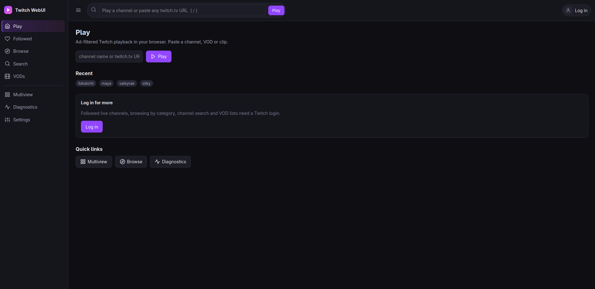
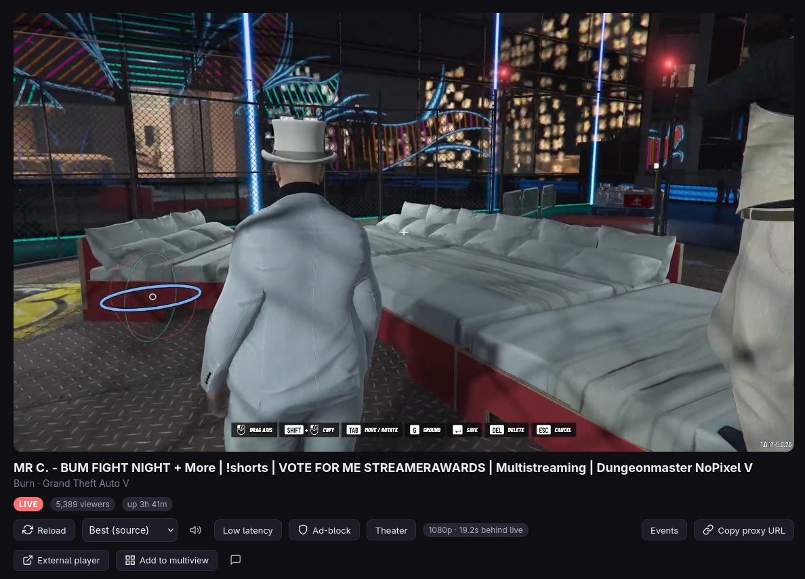
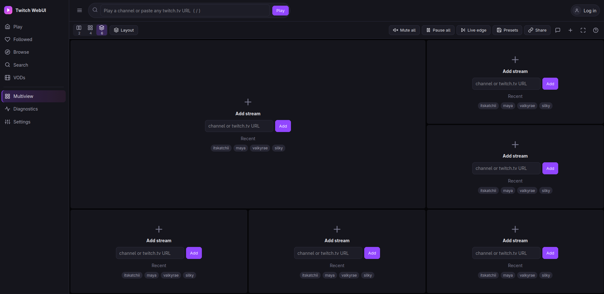
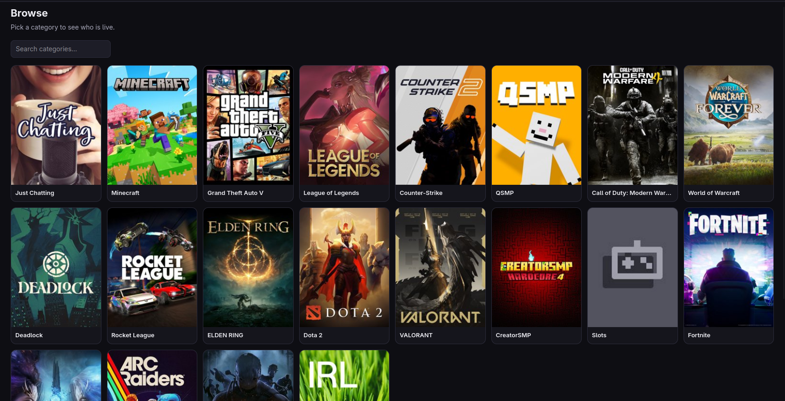
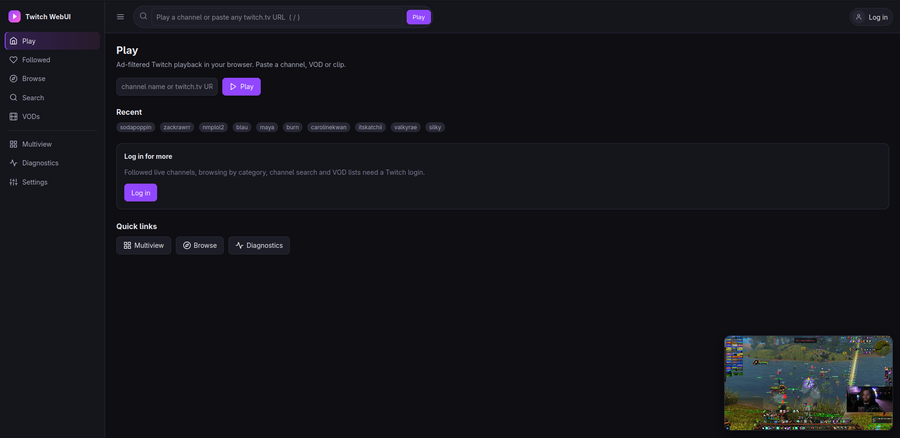
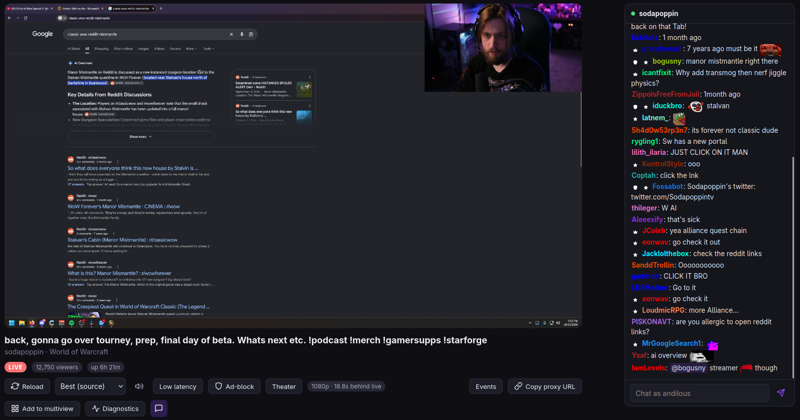
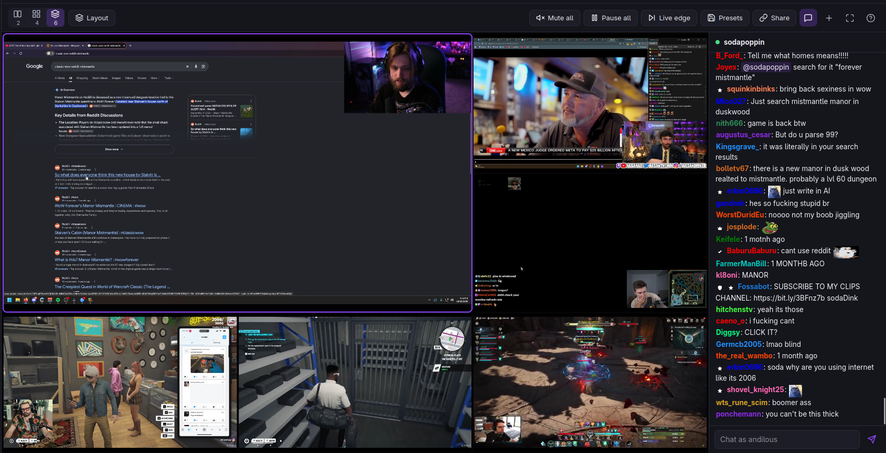

<div align="center">
<h1 align="center"></a></h1>

**A browser port of [proxy-twitch-cli.py](https://github.com/Lunatic16/twitch-cli)** the same ad-block HLS proxy, token flavors, OAuth flow, and browsing endpoints — plus a **Multiview** wall that plays **2, 4, or 6** streams at once.

[](https://github.com/Lunatic16/twitch-webui/actions/workflows/ci.yml)
[](LICENSE)
[](https://nodejs.org)
[](#-docker)
[](#-install--run)
[](https://github.com/YOUR_USERNAME/twitch-webui/pulls)

[Install & Run](#-install--run) · [Docker](#-docker) · [Features](#-features) · [Miniplayer](#miniplayer) · [Chat](#chat) · [Multiview](#multiview) · [Shortcuts](#-keyboard-shortcuts) · [API](#-api)

</div>

## ✨ Highlights

- 🚫 **Ad-block HLS proxy** — five token flavors, ad-marker scanning, smart flavor rotation; if nothing clean exists the ad playlist passes through unchanged, **never quality degradation**
- 🪟 **Miniplayer** — navigate away from a playing stream and it keeps playing in a small, draggable window while you browse
- 💬 **Native chat** — real two-way IRC chat with badges, BTTV/7TV emotes (incl. zero-width stacking) and mention highlighting, in a viewport-fitting panel for watch & multiview
- 💻 **Multiview wall** — 2 / 4 / 6 tiles, grid & featured layouts, presets, drag-and-drop, shareable URLs
- 🔑 **Full OAuth flow** — QR-code login, token validation, optional OS keyring storage
- 🖥️ **1440p60 Streams** — Picks up streams that offer 1440p60 or other high-quality source renditions when a browser session web token is provided.
- 🔍 **Browse & playback** — followed-live, categories, channel search, VODs, clips, audio-only
- 🩺 **Diagnostics** — per-flavor rendition tables, token-mode status, failure reasons
- 🐳 **Docker-ready** — `docker compose up -d --build` and you're live; healthcheck included, config survives rebuilds
- 🧪 **54 unit tests** — pure logic with mocked `fetch` & fake IRC sockets, powered by Node's built-in `node:test`



## 📸 Screenshots

| **Player** | **Multiview** |
|:---:|:---:|
|  |  |
| **Browse** | **MiniPlayer** |
|  |  |

## 🧰 Stack & Why

| Layer | Choice | Why |
|---|---|---|
| **Backend** | Node 20+, ES modules, Express, native `fetch` | Express keeps routing/proxy streaming boring; `fetch` + `AbortSignal.timeout` replaces `requests` with zero dependencies |
| **Frontend** | Vanilla ES modules + **hls.js** (served from `node_modules`, no CDN) | No framework/build step, chosen deliberately: the UI is a handful of views over a JSON API — a bundler would add toolchain weight for no gain, and `npm start` stays a single command |
| **Chat** | IRC-over-TLS bridge (`node:tls`) + the app's existing SSE fan-out | One shared upstream connection per process instead of one per browser tab; no WebSocket server, no new dependencies |
| **Dependencies** | `express` (HTTP + static) · `hls.js` (playback) · `qrcode` (login QR) | The complete list. `keytar` is an **optional** dynamic import behind `use_keyring`; without it, tokens fall back to chmod-600 files |
| **Tests** | Node's built-in `node:test` | No test framework needed |

## 🚀 Install & Run

```sh
npm install
npm start          # http://127.0.0.1:3010
npm run dev        # same with --watch
npm test           # 54 unit tests (pure logic, mocked fetch & fake IRC sockets)
```

**Login** (Settings → Login, or the sidebar button):

1. Open the authorize URL, or scan the QR on your phone.
2. Paste the redirect URL (`http://localhost/#access_token=…`) or a raw token.

Tokens are validated via `oauth2/validate` and stored at `~/.config/twitch-webui/token` (0600). The twitch.tv `auth-token` cookie can be set in Settings for the `web-login` playback-token mode. Logout clears both.

> [!TIP]
> Port **3010** is the default, matching the spec. If another app (e.g. the older `twitch-webui-chatgpt` build) is already on 3010, run `PORT=3011 npm start`.

## 🖥️ Higher Quality Streams (Source / 1440p60)

Some channels stream above 1080p60 (for example a 1440p60 source). Twitch only offers those renditions to a logged-in **web** session, so without one you will only see up to 1080p or just lower 720p60 even though the stream has more. The login created by `--login` is *not* accepted for playback tokens (Twitch answers `401 Unauthorized`), so these streams need the browser session token as well.

**1. Copy your browser's `auth-token` cookie**

In your browser, while logged in to twitch.tv: open DevTools → *Application* (Chrome) or *Storage* (Firefox) → *Cookies* → `https://www.twitch.tv` → copy the value of the cookie named `auth-token`.

**2. Save Web Auth Token**

Navigate back to the App Settings →  Scroll to the bottom of settings → Paste the token value → Save

## 🐳 Docker

```sh
docker compose up -d --build        # → http://localhost:3010
docker compose logs -f              # follow
docker compose down                 # stop (config survives in the volume)
```

- The compose file bind-mounts `~/.config/twitch-webui` into the container (with `:Z` for SELinux on Fedora), so **tokens and settings are shared with a native install** and survive rebuilds. Change the host port with `TWITCH_WEBUI_PORT=3011 docker compose up -d`.
- Inside the container the server binds `HOST=0.0.0.0` automatically (set in the Dockerfile) — required for the port mapping; the app prints its usual LAN-exposure warning. Set `ACCESS_PIN` (compose `environment:`) if the published port is reachable from your LAN.
- `restart: unless-stopped` and a `HEALTHCHECK` (`GET /api/auth/status`) are included.
- "Open in mpv" / external players spawn inside the container, so they only make sense with a native install (or `network_mode: host` + players installed in the image — not included).

Prefer plain `docker run`?

```sh
docker run -d --rm -p 3010:3010 \
  -v ~/.config/twitch-webui:/home/node/.config/twitch-webui:Z \
  twitch-webui-claude
```

## 🌍 Environment Variables

| Var | Meaning | Default |
|---|---|---|
| `PORT` | listen port | `3010` |
| `HOST` | bind host | `127.0.0.1` |
| `TWITCH_TOKEN` | OAuth token (overrides stored token) | — |
| `TWITCH_WEB_AUTH_TOKEN` | twitch.tv auth-token cookie (web-login mode) | — |
| `TWITCH_WEBUI_CONFIG` | alternate config dir/file | `~/.config/twitch-webui` |
| `ACCESS_PIN` | when HOST is non-local: required on `/api` + UI (send as `?pin=` or `X-Access-Pin`) | — |

> [!WARNING]
> Binding `HOST=0.0.0.0` prints a LAN-exposure warning; set `ACCESS_PIN` if you do.

> [!NOTE]
> Proxy playback routes (`/proxy/*`) are **exempt** from the PIN so hls.js can use plain URLs; they are token-free by design (credentials stay server-side). Chat routes (`/api/chat/*`) are **not** exempt — they require a logged-in OAuth token like the rest of the API.

## 🔧 Configuration Keys

Stored in `~/.config/twitch-webui/config.json` — editable in the Settings view or via `PUT /api/config`.

| Key | Notes |
|---|---|
| `audio_only`, `low_latency`, `cache`, `quality`, `page_size` | playback behavior |
| `adblock` | ad-block proxy on/off, default **on** |
| `debug`, `log_file` | logging |
| `use_keyring` | OS keyring token storage (needs optional `keytar`) |
| `theme` | `dark` / `light` |
| `multiview_count` | tiles per wall (2 / 4 / 6) |
| `multiview_layout` | grid / featured / stacked |
| `multiview_tile_quality` | non-focused tile cap, default `480p` |
| `audio_focus` | `focused` / `all-muted` |
| `all_muted_on_start` | start walls muted |
| `recent_channels`, `multiview_presets` | remembered channels & saved walls |

## 🎯 Features

### Playback

The omnibox accepts channel names and any twitch.tv URL — channel, `/videos/<id>`, `clips.twitch.tv/<slug>`, `/clip/<slug>`. Offline channels offer their latest VOD. Leaving the watch page docks the stream in the [miniplayer](#miniplayer) instead of stopping it. Per-stream controls include the quality picker, audio-only, the ad-block event log, "Copy proxy URL", and "Open in mpv" (external players reuse the CLI's argument builders: `--user-agent`, `--referrer`, `--force-media-title`, low-latency and cache flags).

### Ad-block proxy — the core port

1. Masters are fetched for all **five token flavors** (android/mobile first by default); the best rendition for the requested quality is listed first, with every lower-bitrate rendition kept selectable.
2. Variant playlists are scanned for ad markers (`twitch-stitched-ad`, `stitched-ad`, `EXT-X-SCTE35`, `stitchedad`).
3. On ads the proxy **rotates flavors**, using another flavor only if it offers the SAME quality key at ≥ 70% of the requested bandwidth (4s rotation cooldown, per-key "preferred clean URL" cache, fresh-master re-derive on expired URLs).
4. If nothing clean exists, the ad playlist passes through unchanged — **never quality degradation** — with a one-time warning toast.

### Segments

Rewritten through `/proxy/:sid/segment?u=` (whitelisted to `*.ttvnw.net` / `*.jtvnw.net` / `*.twitch.tv`) with the Android UA, Referer, and Range support. Chosen over leaving URLs absolute because it guarantees headers and sidesteps CDN CORS edge cases entirely.

### Browsing

Followed-live, category browse (search + fuzzy fallback over top 100, difflib 0.6 cutoff equivalent), channel search, channel VODs — all cursor-paginated with "Load more".

### Diagnostics

The `--list-qualities` port: per-flavor rendition tables, which token mode succeeded, `TWITCH_WEB_AUTH_TOKEN` state, failure reasons.

### Miniplayer

Navigating away from `/watch` (Followed, Browse, Search, VODs, Settings…) doesn't stop playback — the player is docked in the bottom-right corner so you can keep browsing.

- **Seamless** — the same player and proxy session move between the page and the dock; there is no reconnect or reload, and audio keeps playing
- **Controls** — hover for play/pause, mute, *Back to stream*, and close; clicking the video also returns to the stream
- **Draggable** — drag by the title strip; the position is remembered and kept inside the window
- **Resizable (desktop)** — drag the corner grip at the top-left (aspect ratio is kept, 240–960 px); double-click it to reset. Size is remembered; the grip is hidden on touch and narrow screens
- **Resumes in place** — returning to the same stream (via the dock, the omnibox, or a link) re-adopts the running player, preserving quality, audio-only and the ad-block log
- **Replaced or closed automatically** — playing a different stream replaces it, opening Multiview closes it (tiles run their own players), and a stream that errors or goes offline is not docked

Implemented in `web/js/mini.js`; the watch view keeps its player in a session that outlives the page.

### Chat

Real, two-way Twitch chat — no iframe. The server holds **one IRC-over-TLS connection** to `irc.chat.twitch.tv:6697` per process, authenticated with your OAuth token, and streams messages to the UI over the app's existing SSE pattern; sends go back through the server, which escapes leading `/` commands and enforces Twitch's **18 messages / 30 s** sliding-window limit. No new dependencies: plain `node:tls` on the backend, and the panel renders every message as DOM text nodes (XSS-safe by construction).

- **Read & write, with graceful gates** — `chat:read` / `chat:edit` are in the default OAuth scopes and the status endpoint exposes a `canChat` flag; a login gate appears when the token is missing or lacks chat scopes, reconnects automatically after you log in, and a one-click fallback swaps in the official **read-only Twitch embed**
- **Real chat rendering** — inline SVG badges (broadcaster, mod, VIP, sub + months, founder, prime, partner, staff, artist), Twitch's default name palette with hash fallback colors, classic colored `/me` actions, a 500-char counter, optimistic self-messages, and clickable sender names that prefill a reply
- **BTTV & 7TV emotes** — global + per-channel sets from `api.betterttv.net` / `7tv.io`, cached server-side (globals 6 h, channel 1 h, failures retried after 5 min); channel emotes win code collisions over globals, and 7TV **zero-width** emotes stack onto the preceding emote — provider or CDN failures degrade silently to plain text
- **Mention highlighting** — messages that mention you get a tinted row + accent bar (computed server-side, so history lines highlight too), and `@name` tokens anywhere become clickable chips that prefill a reply
- **Moderation-aware** — timeouts/bans and single-message deletes update or strike lines in place, sub/raid `USERNOTICE`s and `NOTICE`s appear as system lines, and mod clears remove or wipe the log
- **Resilient** — the last 40 messages replay on every (re)connect, PING/PONG keepalive with backoff reconnects, and per-channel rooms are refcounted so the watch view and the multiview focused tile share one bridge connection
- **Fits the viewport** — the watch-view chat column is pinned with a JS-measured height so the composer never falls below the fold (the message list scrolls inside the panel); narrow screens keep the stacked under-player layout

Implemented in `server/chat.js` (IRC bridge + pure IRC parsing helpers), `server/emotes.js` (BTTV/7TV emote service) and `web/js/chat.js` (the panel); the same module is mounted as the focused-tile chat in Multiview.

| **Chat** | **Chat Multiview** |
|:---:|:---:|
|  |  |

### Multiview

- **2 / 4 / 6 tiles** — grid + featured ("1 large + N small") layouts, stacked option for 2
- **Per-tile controls** — mute / volume / quality / adblock / reload / fullscreen / remove
- **Audio focus** — focused or all-muted
- **Offline overlay** — retry / replace / latest VOD
- **Drag-and-drop swap** and click-to-focus (promotes to the big slot)
- **Native chat** for the focused tile — the same [chat panel](#chat), sharing one IRC bridge connection
- **Presets** saved server-side, plus shareable URLs: `#/multiview?c=a,b,c&layout=2x2&n=4`
- **Smart quality capping** — non-focused tiles are capped to `multiview_tile_quality` via hls.js `autoLevelCapping`: instant on focus change, no extra GQL traffic
- **Resilient tiles** — start staggered 250 ms, pause loading when the tab is hidden, and fatal errors recreate the tile with a fresh session

## 🎮 Keyboard Shortcuts

| Key | Action |
|---|---|
| `1`–`6` | focus tile |
| `M` | mute focused |
| `Shift+M` | mute all |
| `F` | fullscreen wall (per-tile button for single-tile fullscreen) |
| `L` | cycle layout |
| `A` | add stream |
| `Esc` | exit fullscreen |
| `?` | help |

## 🔌 API

```
# Auth
GET  /api/auth/status         POST /api/auth/login {redirectUrl|token}
POST /api/auth/logout         PUT  /api/auth/web-token
GET  /api/auth/authorize-url  -> {url, qr(svg)}

# Config & playback
GET/PUT /api/config
POST /api/resolve {input}
GET  /api/stream/:login/info
POST /api/play {input, quality?, adblock?, audioOnly?, lowLatency?}
     -> {sessionId, playbackUrl, meta} | {offline, latestVod}
DELETE /api/play/:sessionId   GET /api/play/:sessionId/events (SSE)
GET  /api/events (SSE: toasts + debug logs)

# Chat (IRC bridge; auth required)
GET  /api/chat/:login/events (SSE: init/status/message/notice/clear/delete/chat-error)
POST /api/chat/:login/message {text}    (rate-limited: 18 msgs / 30 s)
GET  /api/chat/:login/emotes -> {emotes:[{provider, id, code, zero?}], counts, errors, cached}

# Browsing
GET  /api/followed?after=     GET /api/games/search?q=  GET /api/games/top
GET  /api/games/:id/streams?after=
GET  /api/channels/search?q=  GET /api/channels/:login/vods?after=

# Diagnostics & external players
GET  /api/diagnostics/:login  -> per-flavor renditions + token modes
POST /api/external-player {sessionId, player}

# Multiview
GET/POST/DELETE /api/multiview/presets   GET/POST /api/multiview/recent

# Proxy
/proxy/:sid/master.m3u8   /proxy/:sid/variant?u=&n=&bw=   /proxy/:sid/segment?u=
```

## 🚧 Known Limitations

- Twitch can change GQL fields, ad injection, or flavor behavior at any time; the token-flavor/rotation logic mirrors the CLI and may need the same upstream fixes.
- GQL field names differ from Helix (`viewersCount`/`createdAt` vs `viewer_count`/`started_at`) — already accounted for here.
- VOD/clip playback is direct (no ad rotation), matching the CLI.
- The game fuzzy match uses normalized Levenshtein, not CPython's `difflib.SequenceMatcher` — close, not identical.
- `keytar` must be installed separately if you want keyring storage.
- The miniplayer holds one stream at a time and doesn't show chat; the chat panel reloads when you return to the watch page.
- Chat sends are rate-limited server-side (18 msgs / 30 s per process) and require a token with `chat:read` / `chat:edit` — logins made before the chat feature must re-login.
- BTTV / 7TV emotes are best-effort cosmetics — provider API or CDN failures fall back to plain text.
- The optional read-only chat embed fallback requires the page host to match `location.hostname` (Twitch embed `parent` rule); native chat has no such restriction.

> [!CAUTION]
> **VOD URLs contain the token by nature — don't share "Copy URL" output for VODs.** Live proxy URLs are token-free and safe to share.

## 📄 License

Released under the [MIT License](LICENSE).
